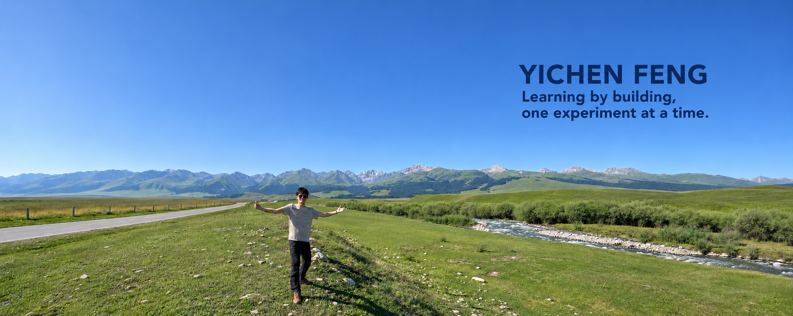

<p>
  <a href="https://www.instagram.com/charlievdu/"></a>
  <a href="https://xhslink.cn/o/5VaZtFo5Wky"></a>
  <a href="https://www.linkedin.com/in/yichen-f-bb76583b8"></a>
  <a href="https://yichencharlie.github.io/"></a>
</p>

<h2>Hi, I'm Yichen 👋</h2>

<p>I studied Computer Science and Technology at Shanghai Maritime University. I'm interested in machine learning systems — how models work, how they run, and how to make inference more efficient.</p>

<p>I learn through small experiments, careful benchmarks, and notes on what I find.</p>

<p><a href="https://yichencharlie.github.io/">Personal website ↗</a> &nbsp; · &nbsp; <a href="https://github.com/YichenCharlie?tab=repositories">Repositories</a></p>

<h2>🌱 A little about me</h2>
<ul>
<li>🔬 Exploring LLM inference, GPU profiling, and serving performance.</li>
<li>📚 Building a foundation in neural networks and continuing with Stanford CS336.</li>
<li>🤖 Previously worked on computer vision and embedded robotics projects.</li>
<li>🎧 Outside of code: music, games, and travel.</li>
</ul>

<h2>Languages &amp; tools</h2>
<p> &nbsp;  &nbsp;  &nbsp;  &nbsp;  &nbsp;  &nbsp;  &nbsp;  &nbsp;  &nbsp;  &nbsp; </p>
<p><sub>Python · C · C++ · MATLAB · Shell · PyTorch · OpenCV · NumPy · Linux · Git · LaTeX</sub></p>

<h2>Selected projects</h2>

<p><a href="https://github.com/YichenCharlie/llm-serving-benchmark"><b>LLM Serving Benchmark</b></a><br>
vLLM experiments on throughput, latency, prefix caching, and scheduling with Qwen2.5 on an RTX 3090.</p>

<p><a href="https://github.com/YichenCharlie/financial-text-inference"><b>Financial Text Inference</b></a><br>
Financial news classification with BERT, from computation verification to GPU profiling and mixed-precision inference.</p>

<p><a href="https://github.com/YichenCharlie/neural-networks-to-cs336"><b>Neural Networks → CS336</b></a><br>
Three PyTorch experiments: XOR classification, Fashion-MNIST, and a character-level bigram language model.</p>

<p><a href="https://github.com/YichenCharlie/cs336-assignment1-basics"><b>CS336 · Assignment 1</b></a><br>
Learning language modeling basics independently by following Stanford CS336, using the official assignment starter code.</p>

<h2>📊 Languages in my code</h2>

<!-- STATS:START -->
```text
Languages across my public code

Jupyter Notebook     ████████████─────────────    49.43 %
Python               ██████████───────────────    40.60 %
JavaScript           █────────────────────────     2.89 %
HTML                 █────────────────────────     2.66 %
CSS                  █────────────────────────     2.52 %
```

<sub>Top 5 languages; percentages use all language bytes. Excludes forks and this profile. Notebook files are counted separately; includes starter code. Updated 2026-11-13 UTC.</sub>
<!-- STATS:END -->

<hr>
<p><sub>Build something small. Understand it a little better. Repeat.</sub></p>
